# moat

Gateway for APIs: keeps API secrets out of the frontend, proxies and gates endpoints, and enforces
rate limits and budgets on the hosting you already have.

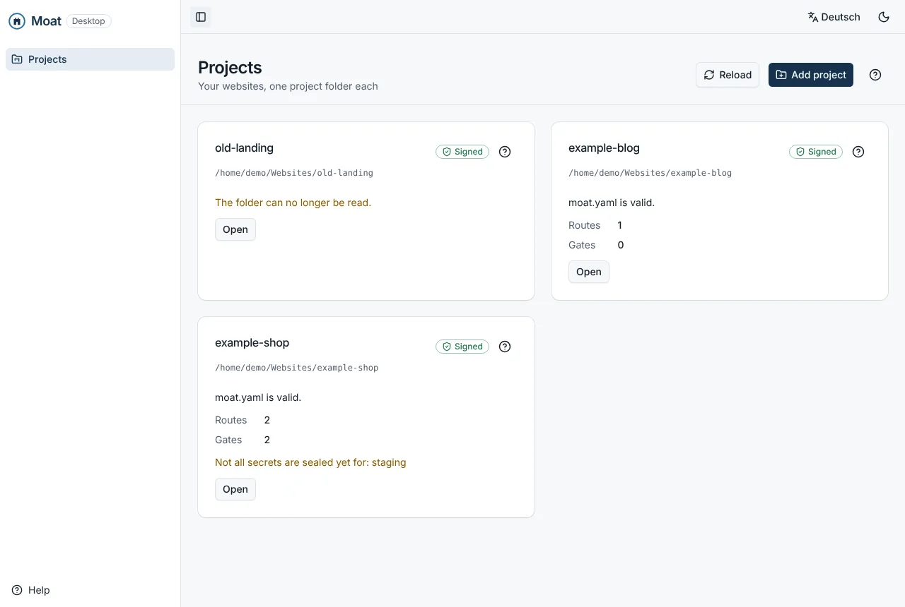

---

## What it is

A website that calls an API from the browser (a newsletter form that creates a HubSpot contact,
a chat box that talks to OpenAI) needs a secret, and the browser must never see it. Moat puts a
small **gate** on the website's own hosting. The browser calls the gate, and the gate:

- forwards **only the routes you approved**: exact method and path, a fixed upstream address,
  HTTPS only;
- adds the API secret on the way out, so the secret never reaches the browser;
- **limits** what a visitor can do: rate limits per visitor and in total, body size, content
  type, and which websites may call it;
- trusts nobody it does not have to. It accepts a new configuration only when it is signed with
  your key, and it has no admin endpoint on the internet.

The rule above all others: **a fully compromised Moat Cloud must not compromise a gate**.
Configuration is data, never code. Secrets are sealed for one gate and can be opened only there.
The gate's own local policy always wins over anything it receives.

> **Status (October 2026):** early development. Working today: Moat Core, the `moat` CLI, the PHP
> gate (signed bundles, exact routing, SSRF guard, CORS, rate limits, locking a gate or a whole
> environment) and Moat Desktop (project list, a view of each project, and editing environments
> and locks). Not built yet: Moat Cloud, editing routes and signing in the desktop, quotas and
> budgets, the setup wizard. The full target is in
> [ANFORDERUNGEN.md](ANFORDERUNGEN.md) (German).

## How it fits together

```
 Browser ──HTTPS──▶ Moat Gate (PHP, on your hosting) ──HTTPS + secret──▶ API (HubSpot, OpenAI, …)
                         ▲
                         │ signed bundle (config + sealed secrets), uploaded by you
                         │
 moat.yaml ──▶ Moat CLI / Moat Desktop (your computer: sign with your key file, seal secrets)
```

| Component        | Where                                    | What it does                                                                     |
| ---------------- | ---------------------------------------- | -------------------------------------------------------------------------------- |
| **Moat Core**    | `libs/core`                              | Config schema, bundle building, signing, sealing secrets: the one implementation |
| **Moat CLI**     | `apps/cli`                               | `moat keygen`, `validate`, `gate add`, `env add`, `secret seal`, `build`, locks  |
| **Moat Desktop** | `apps/desktop` + `apps/api` + `apps/web` | The app for your computer: projects, gates and routes at a glance                |
| **Moat Gate**    | `gates/php`                              | One PHP file on the website's hosting, enforcing everything locally              |
| **Moat Cloud**   | `apps/api` + `apps/web`                  | Dashboard and API, as SaaS or self-hosted (planned)                              |

### Trust modes

Every gate shows which trust mode is in force, always with the same labels and the same honest
sentence ([ANFORDERUNGEN.md §2.9](ANFORDERUNGEN.md)):

| Mode                        | Who approves a change               | If Moat Cloud is hacked …                                                                                             |
| --------------------------- | ----------------------------------- | --------------------------------------------------------------------------------------------------------------------- |
| **Convenient** (0)          | Moat Cloud                          | … an attacker can change your routes within the local limits of your gate, but cannot read secrets or run code.       |
| **Signed** (1)              | You, with your key file             | … an attacker cannot change anything. In the browser this holds only partly; full guarantee with Moat Desktop or CLI. |
| **Signed with passkey** (2) | You, with a passkey or security key | As “Signed”, and in addition your key cannot be stolen.                                                               |
| **Own signer** (3)          | Your own service or CI              | … an attacker cannot change anything.                                                                                 |

Moat Desktop and the CLI always work in **Signed** mode: there is no server a gate could trust.

## Moat Desktop

Moat Desktop runs on your computer without an account or a server. It is **project-based**:
each website is a project, and a project is a folder (the project folder, see below). The app
keeps a list of your projects; the projects themselves stay in their folders, where Git can track
them.

### Projects

The start page lists every project with the state of its `moat.yaml`, its number of routes and
gates, and gates that still lack a secret. **Add project** opens the system's folder dialog; the
project opens right away. A project whose folder was moved or deleted stays in the list and says
so, and **Remove from list** takes the entry away without touching the folder.

| First start                                                 | Dark mode                                                                  |
| ----------------------------------------------------------- | -------------------------------------------------------------------------- |
| 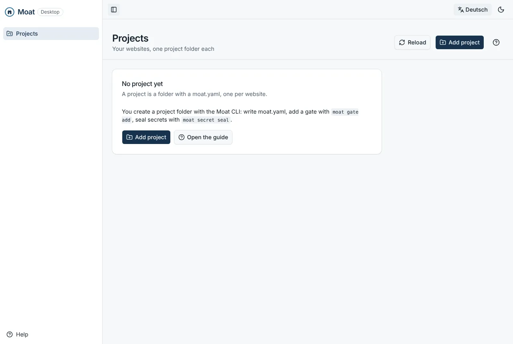 | 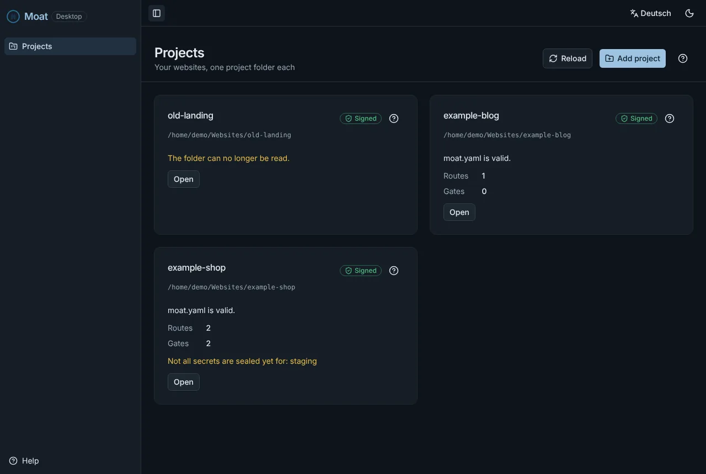 |

### Overview

Each project has a workspace with three tabs. **Overview** shows the folder, the trust mode with
its “If Moat Cloud is hacked …” sentence, and whether `moat.yaml` is valid. Errors are listed
with line and column. **Show in folder** opens the folder in the file manager.

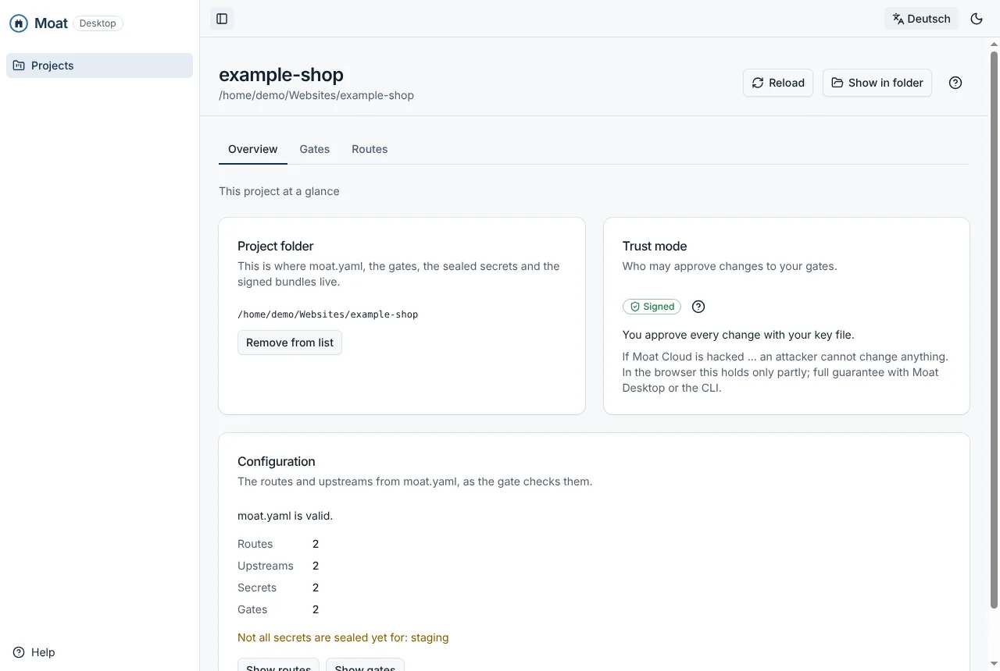

### Gates

**Gates** shows every gate pinned in the project:

- its id and the **fingerprint** of its key, to compare group by group with what the gate printed
  when it was installed;
- the latest bundle built;
- the secrets sealed for it, by name and version only (the app never sees a secret);
- secrets the configuration needs that are not sealed for this gate yet.

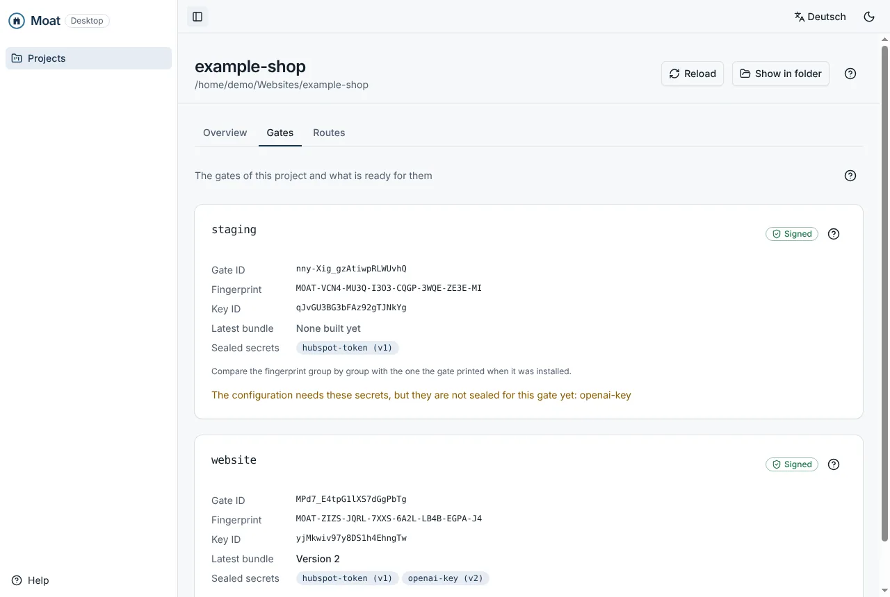

Each project also has an **Environments** card: every environment (dev, staging, production …)
with its gates, which of them are locked, and the gates that belong to no environment. Here you
**add an environment** (type its name, then **Add environment**) and **lock** or **unlock** a
whole environment. Under **Gates**, each gate has a list to choose its **environment** and a
**Lock gate** / **Unlock gate** button.

Every change is written to `moat.yaml` right away, through the same edits as the CLI: comments,
key order and formatting stay as you wrote them. If the file changed on disk since the app read
it (an editor, `git pull`), nothing is written; the app says so and reads the project again. A
change reaches a gate only with the next signed bundle (`moat build <gate>`), and the app says
that after every change.

| Environments and locks                                                     | A gate's environment and lock                                                   |
| -------------------------------------------------------------------------- | ------------------------------------------------------------------------------- |
| 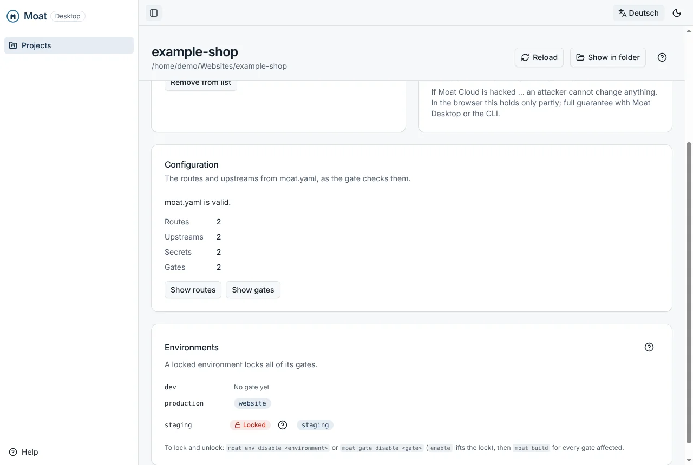 | 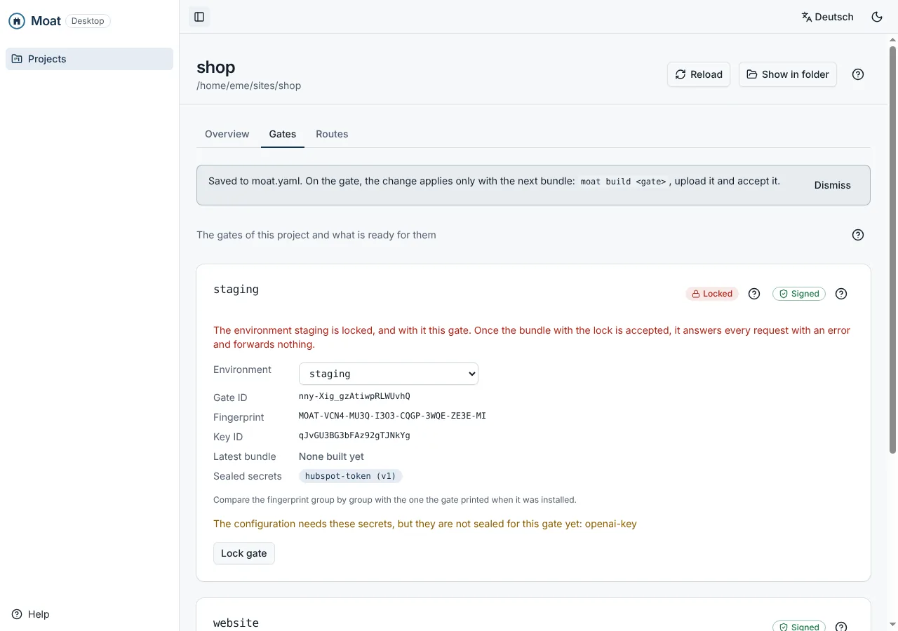 |

A locked gate carries a **Locked** badge under **Gates**, with the reason (the gate itself or its
environment). The app also compares `moat.yaml` with the latest bundle built: as long as that
bundle does not carry the lock yet (or still carries one you lifted), it says so and names the
`moat build` that fixes it.

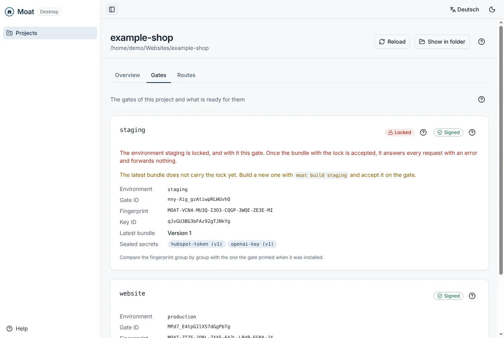

### Routes

**Routes** shows every route as the gate enforces it:

- method and exact path;
- the upstream address it forwards to;
- the websites allowed to call it;
- its rate limit and maximum body size;
- for each upstream, which sealed secret it sends (by name).

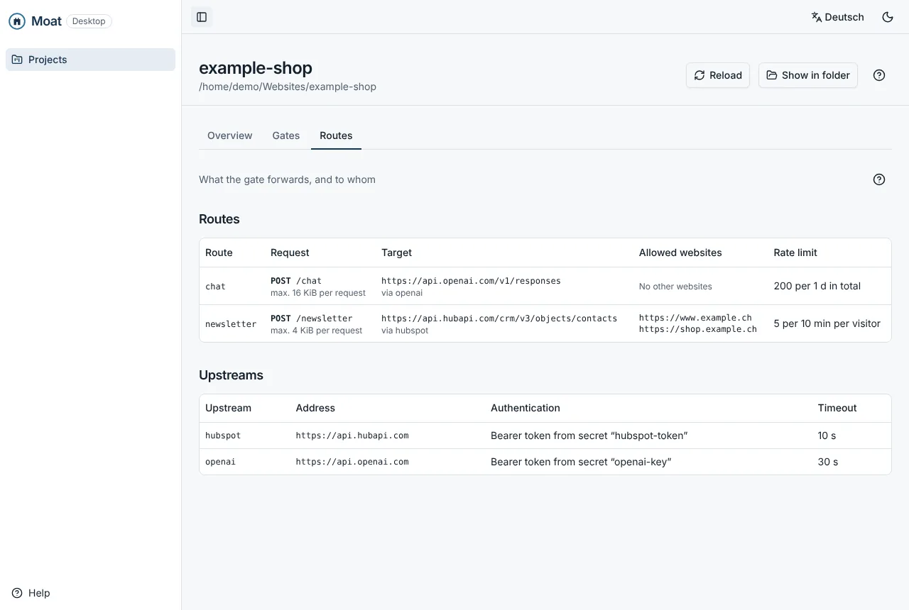

### Help

**Help** is a step-by-step guide in the order of the work: projects, installing a gate, the trust
mode, upstreams and secrets, routes, limits, releasing, environments and locks, and privacy. It has frequent questions, a
search, and deep links. Every page and every trust-mode badge has a **?** that opens the
matching step.

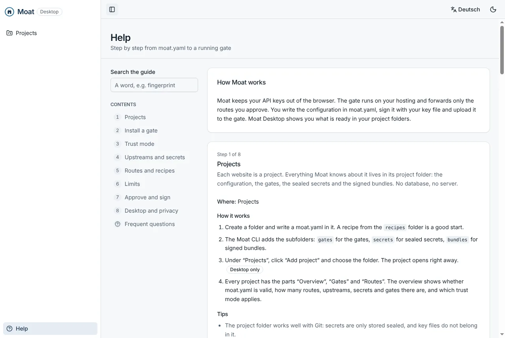

The app speaks **German (Switzerland)** and **English**. The language toggle is at the top
right, next to light and dark mode.

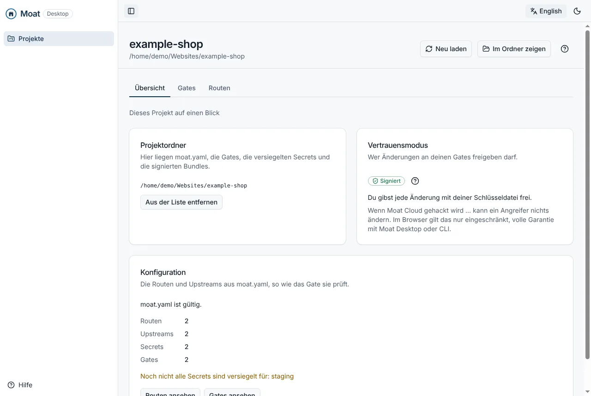

### How the desktop keeps your data safe

- The app's API runs inside the app on `127.0.0.1` only. It answers only requests that carry a
  token created at each start and the exact `Host` (DT-16: no other program or web page on your
  computer can reach it, not even through DNS rebinding).
- The window has no Node.js access and runs sandboxed. It talks to the app only through two
  functions: add a project, and show a project's folder. Folders are chosen in the system dialog
  and never typed in by the page (DT-08).
- Project folders are read only inside the folder: symbolic links pointing elsewhere, special
  files and oversized files count as missing.
- The app writes only `moat.yaml`, and only through a fixed list of edits (add an environment,
  lock or unlock, assign a gate) that take names, never free text. The file is replaced
  atomically and never written through a symbolic link. Nothing the window does reaches a gate
  without a bundle signed with your key (T-56).
- Secrets are reported by name and version. Ciphertext never leaves the folder (SEC-31).

## Quick start

Built versions (gate, CLI, desktop installers) are on the
[releases page](https://github.com/oldjazjef/moat/releases); see [Releases](#releases). To build
from source, you need Node 22 and pnpm 11 (pinned in `package.json`). The gate needs PHP ≥ 8.2 with `sodium`,
`curl`, `json` and `hash` on the hosting.

```bash
pnpm install
pnpm build              # the CLI → dist/apps/cli/moat.cjs
pnpm build:gate-php     # the gate → gates/php/dist/moat-gate.php
pnpm start:desktop      # Moat Desktop in development

alias moat="node $PWD/dist/apps/cli/moat.cjs"   # the CLI works in the current folder
```

The commands below run inside the project folder.

### 1. A signing key

```bash
moat keygen ~/keys/me.moatkey
```

The key file is protected with a passphrase (Argon2id) and never belongs in Git. The command
prints the public key and its fingerprint.

### 2. A project folder with a `moat.yaml`

Start from a recipe in [`recipes/`](recipes/), for example the HubSpot newsletter:

```yaml
# yaml-language-server: $schema=../schema/moat.schema.json
version: 1

upstreams:
  hubspot:
    origin: 'https://api.hubapi.com'
    auth:
      type: bearer
      secret: hubspot-token # a name, never the value
    timeout: '10s'

routes:
  newsletter:
    method: POST
    path: '/newsletter'
    upstream: hubspot
    upstreamPath: '/crm/v3/objects/contacts'
    maxBodySize: '4KiB'
    rateLimit:
      requests: 5
      window: '10m'
    origins: ['https://www.example.ch']
```

`moat validate` checks it and reports errors with line and column. Editors with the YAML
language server complete and check it through [`schema/moat.schema.json`](schema/moat.schema.json).

### 3. Install the gate

Upload `moat-gate.php` to the website, then on the server:

```bash
php moat-gate.php install --signer=<public key from moat keygen>
```

It prints the gate's id, its key and their fingerprints, and the line that pins it in your
project:

```bash
moat gate add website --gate-id=<id> --box-key=<key>
```

Compare the fingerprint `gate add` prints with the one on the server, group by group. Moat Desktop
shows it under **Gates** as well.

### 4. Seal the secrets

```bash
moat secret seal website hubspot-token
```

You type the value at a hidden prompt (or pipe it in). It is sealed for this one gate
(X25519 + XChaCha20-Poly1305, bound to the gate id and the secret's name) and written to
`secrets/website/hubspot-token.json`. Only the gate can open it.

### 5. Policy, build, upload

```bash
moat policy suggest > policy.json            # the narrowest policy for this config
php moat-gate.php policy policy.json               # on the server: the gate's local limits
moat build website --key ~/keys/me.moatkey     # → bundles/website/1.json, signed
php moat-gate.php accept 1.json                    # on the server: verify and activate
```

The website now calls `POST https://www.example.ch/moat-gate.php/newsletter`. Every request goes
through the checks in [gates/php/README.md](gates/php/README.md): exact route, origin, body size,
content type, rate limits, and a pinned public upstream address.

### 6. Environments and locks

Environments group your gates (FR-01). A gate belongs to at most one:

```bash
moat env add staging
moat gate add website-staging --gate-id=<id> --box-key=<key> --env staging
moat gate assign website production                 # an existing gate (--force moves it)
```

This writes to `moat.yaml`, keeping your comments and order:

```yaml
version: 1
environments:
  staging:
    enabled: false # locked: every gate in it refuses every request
  production: {}
gates:
  website-staging:
    environment: staging
  website:
    environment: production
```

Lock a whole environment or a single gate, and unlock it the same way with `enable`:

```bash
moat env disable staging      # names every gate affected
moat gate disable website
moat build website --key ~/keys/me.moatkey
php moat-gate.php accept 2.json                  # on the server
```

The lock is part of the next bundle (`"enabled": false` in its config), signed like everything
else. Once the gate accepts it, it answers **every** request with 503 `gate_disabled` and forwards
nothing, not even a CORS preflight; `php moat-gate.php status` shows `LOCKED`. Lifting the lock
takes a new, higher bundle, so replaying an old, unlocked one does not work. A locked bundle is
checked like any other: every secret the config uses must be sealed for the gate and it must
fit the gate's policy, otherwise `moat build` refuses it. Update the gate first: an older gate
refuses a bundle with a lock (`config_invalid`) and keeps serving its last one.

### The project folder

```
moat.yaml                       the configuration: routes, upstreams, environments, locks (no secrets)
gates/<gate>.json               a gate's public identity, pinned after comparing fingerprints
secrets/<gate>/<name>.json      secrets sealed for that gate (ciphertext only)
bundles/<gate>/<version>.json   signed bundles, ready to upload
```

Everything in it is safe to commit: there are no plain secrets and no private keys. Moat Desktop
reads exactly this folder.

## Development

| Command               | What it does                                                                            |
| --------------------- | --------------------------------------------------------------------------------------- |
| `pnpm check`          | The gate for TypeScript: lint, lint budget, yamllint, Prettier, tests, build, typecheck |
| `pnpm check:gate-php` | The gate for PHP: composer validate, PHP-CS-Fixer, PHPStan (max), PHPUnit, conformance  |
| `pnpm check:all`      | Both; what CI runs                                                                      |
| `pnpm test`           | All TypeScript unit tests (Vitest)                                                      |
| `pnpm conformance`    | The shared conformance suite against Moat Core and the PHP gate                         |
| `pnpm start:desktop`  | Builds the API and the UI and starts Moat Desktop                                       |
| `pnpm schema`         | Regenerates `schema/moat.schema.json` from the Zod schema                               |
| `pnpm vectors`        | Regenerates the crypto test vectors                                                     |

The stack: Nx and pnpm; Angular 22 with spartan.ng and Tailwind 4; NestJS 11; Electron 42;
Vitest; libsodium; PHP 8.2+ for the gate without runtime dependencies. Conventions, security
rules and environment gotchas are in [CLAUDE.md](CLAUDE.md).

Every API endpoint has an entry in the authorization matrix
([`apps/api/src/security/authz-matrix.ts`](apps/api/src/security/authz-matrix.ts)), and the
app is tested against the OWASP Top 10 and API Top 10
([docs/SECURITY-TESTING.md](docs/SECURITY-TESTING.md)).

## Releases

A release is made by hand in GitHub, no local tools needed: **Actions → Release → Run workflow**
on `main`, choose which part of the version to raise (`patch`, `minor`, `major`) or type an exact
version, and start it. The workflow ([`.github/workflows/release.yml`](.github/workflows/release.yml))
refuses to run unless CI passed on that commit, builds everything and publishes the release
`vX.Y.Z` with these files:

| File                                          | What it is                                               |
| --------------------------------------------- | -------------------------------------------------------- |
| `moat-gate.php`                               | The gate, one file; version and commit are in its header |
| `moat.cjs`                                    | The CLI (`node moat.cjs version`), needs Node 22         |
| `Moat-Setup-X.Y.Z.exe`                        | Moat Desktop for Windows (x64)                           |
| `Moat-X.Y.Z-arm64.dmg` / `Moat-X.Y.Z-x64.dmg` | Moat Desktop for macOS (Apple silicon / Intel)           |
| `Moat-X.Y.Z.AppImage`                         | Moat Desktop for Linux (x64)                             |
| `SHA256SUMS.txt`                              | SHA-256 checksums of all files above                     |

While it builds, the release is a draft that nobody else sees; it is published, and the tag
created, only when every file is there. If a build fails, the draft is deleted again.

**Not signed yet.** The installers carry no code signature, so Windows SmartScreen and macOS
Gatekeeper warn on first start (the release notes say how to open them anyway), and the gate file
has no release signature (SEC-60) or SBOM (SEC-61) yet. Until then, compare the SHA-256 checksum
with `SHA256SUMS.txt` before installing.

## Documentation

- Requirements: [ANFORDERUNGEN.md](ANFORDERUNGEN.md) (German; IDs like `SEC-41`, `FR-11`, `DT-03`)
- Threat model: [docs/THREAT-MODEL.md](docs/THREAT-MODEL.md)
- Crypto specification: [docs/CRYPTO.md](docs/CRYPTO.md)
- Security testing: [docs/SECURITY-TESTING.md](docs/SECURITY-TESTING.md)
- The PHP gate: [gates/php/README.md](gates/php/README.md)
- Stack, conventions and rules for contributors (and Claude): [CLAUDE.md](CLAUDE.md)
- Reporting a vulnerability: [SECURITY.md](SECURITY.md)

## License

[MIT](LICENSE)
